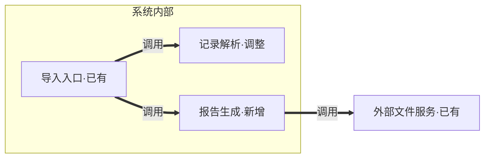

# Plan: <spec slug>

<!--
Agent 将模板复制到目标 spec 目录后填写，定稿前删除注释和占位。
spec.md（简称 spec）是需求说明，plan.md 是执行计划；R1 等编号代表需求条目。
Agent 应让全文首先供人理解，再供 Agent 执行。Agent 用用户、Agent、系统明确责任，一句话说一件事。
新文档不用表格。Agent 用 #### 标题分隔记录，每个固定字段单独成行，值中的 | 保留原样。
方案确认（A）由用户决定是否接受方案。主 Agent 在此之前只写第 1–2 节，后半段为空。
开工确认（B）由用户决定是否进入实现。主 Agent 在此之前编写设计与任务，不得修改 spec 或已确认的第 1–2 节。
A 单向落实 spec，B 单向落实 A 并把每条需求对应到任务和验收。Agent 不补需求、不另造方案，不为更强保证增加验证系统。具体函数、变量、参数和枚举值一般留给实现阶段，只有上游明确要求或必要协作约定才在计划固定。
A、B 各最多一次编写、两轮修改、三次独立核查。核查者只读，不运行 lint（格式和部分规则的校验脚本）。
主 Agent 在首次编写后运行 lint，中间修改后不运行；修改后的核查通过时，主 Agent 才运行最终 lint。
首轮核查通过且正文未改时，主 Agent 沿用首次 lint 结果。到上限仍有阻塞或最终 lint 失败时，主 Agent 停止并交用户决定。
-->

- Spec：`pNN-NNN-<slug>`（spec v1 / approved）
- Status：`draft`

<!--
状态值只有四个。draft：只有方案摘要，正在等用户决定方案，第 3–6 节必须为空。design-ok：方案已确认，设计与任务尚待检查与用户批准。approved：用户已允许实现。stale：spec 实质变化，须先解决上游。

计划获批准后要修订时，Agent 先把 Status 改为降级值，再改正文。重开方案改为 draft 并清空第 3–6 节；只重开设计与任务改为 design-ok，第 1–2 节不动；只勾选任务、补记第 6 节核查记录或改错别字不降级。spec 重新批准后，方案未受影响时把 stale 改为 design-ok，只重做开工确认；方案要调整时把 stale 改为 draft 并清空第 3–6 节。
-->

## 1. 方案摘要

<!-- 摘要正文最多 30 行，覆盖核对记录不计入。先写结果，不用文件名或术语代替画面。需求本身讨论这些对象时除外。 -->

**用户会看到的变化**：

- <默认状态下的具体结果>
- <其他状态或操作产生的具体差别>

**怎么做到**：<数据从哪来、谁处理、状态和边界在哪里>

**为什么这么切**：<相比放弃的做法，实际减少或增加什么工作>

**代价**：<需要付出什么、哪些只能手工判断>

**需要用户决定的事项**：见 2.1。

<!-- 有具体选择就列问题、选项与后果；没有则写 **无需用户决定**。不要把同一决定在两处重复请用户批准。 -->

**覆盖核对**：

#### R1 的可见结果
- R：R1
- 落点：<照抄“用户会看到的变化”中的 6–20 字>

#### R2 的内部约束
- R：R2
- 落点：无 —— 见「代价」段

<!-- Agent 为每条 R 填写一个记录。只有确无可见结果时，Agent 才写“无”，不把内部测试和审计硬塞进用户画面。 -->

## 2. 约束

### 2.1 需要用户确认的例外

<!-- Agent 为每个决定单独填写一个记录；没有例外时写“无”。Agent 提出覆盖时给出文档与条款，用不超过40字的一句话说明理由，并写明可判断的失效条件。Agent 发现需要“回 spec”或“先补约定”时停止。 -->

#### <例外名称>
- 这次要打破什么：<覆盖 docs/standards/report.md REPORT-01，或仅本次等>
- 为什么：<具体理由>
- 什么时候回到标准：<可判断的条件>

### 2.2 Agent 遵循的既有规范

<!-- Agent 按主题合并规范。某条款被2.1部分覆盖时，Agent 明确只沿用哪部分，不能整体引用。Agent 只列已生效规范，不重复需求。 -->

#### <规范主题>
- 出处：`docs/standards/<name>.md`
- 条款：<条款号>
- 要求：<本次适用的要求及范围>

### 2.3 按惯例自主决定

<!--
Agent 记录检查过、但按当前场景通行做法自己定下、没有向用户提问的选择。一行一条，写清场景和做法，例如：
- 启动时数据库不可达：命令行工具按通行做法停止启动并报错，不降级为离线可用。
没有这类选择时写「无」。本节在方案确认（A）中写入，供用户一次性浏览并推翻任意一条；被推翻的转成访谈问题。开工确认（B）不修改本节。
-->

- <场景>：<Agent 按通行做法定下的做法>

## 3. 设计

<!-- 在方案确认（A）中，Agent 让第3–6节保持为空。在开工确认（B）中，Agent 才填写以下骨架和例子，不提前确定设计，也不重新选择方案。 -->

### 3.1 结构与数据流

<!--
Agent 按下面顺序组织本次确有需要的内容，不必照抄所有小标题。先让读者知道组件在哪里、怎样协作，再展开必要约定。Agent 首次使用抽象职责名称时，用一句话解释含义或用途；首次组件名称要有说明或就近指向组件记录。

**架构模式与边界**
多组件或跨组件协作时，Agent 先给 Markdown 内嵌 Mermaid 架构图，标明系统内外、相关组件的已有/新增/调整状态及关键第三方库的使用者。下面仅演示调用关系，不要求新增这些组件或分层：

图例：箭头从调用方指向被调用方，不表示数据流或时间顺序。若图表示代码依赖，Agent 相应说明箭头含义，不混用关系。关键第三方库按实际方案标出使用者，没有则不虚构。
Agent 只在项目已采用或 A 已明确选择架构模式时说明模式和层次归属。局部变更没有实质组件关系时，用短文说明结构和无需架构图的原因，不生成装饰性图表。

**组件说明**
Agent 为相关组件填写简短记录，可合并不影响定位的文字，不为字段拆文件、建接口或新增层次。“组件”“模块”是逻辑职责，不自动代表独立 package、进程或部署单元。
#### <组件名称及含义>
- 状态：<已有、新增或调整>
- 作用：<负责什么；必要时说明不负责什么；调整组件说明原有职责与本次变化>
- 代码位置：<已有或计划新增的仓库相对落点>
- 关键依赖：<直接相关的内部组件、第三方库或外部系统；没有则如实说明>
层次归属只在项目已有分层或已确认方案需要时追加，不作为必填字段。

**关键数据流或交互流程**
顺序、状态或跨组件协作不易只靠文字理解时，Agent 选择 Mermaid flowchart、sequenceDiagram 等合适形式。可以分别绘制启动、正常处理、失败恢复或停止等流程，不固定图的类型和数量；简单流程不画图时简要说明原因。
图中的组件名称与架构图、正文一致，图与已确认方案、任务及检查安排一致。Agent 只画影响理解的关键判断和失败分支，正文保留约束、错误语义与资源责任，不逐句复刻长段落，不为画图新增行为、状态或验收要求。

**数据模型**
只有本次引入或改变需要跨组件共同理解的核心数据结构、持久数据、状态迁移或兼容约束时才单列。否则删除该小标题，不填“不涉及”。只说明协作所需的信息及含义，不写成字段、类型或私有声明的代码说明书。

Agent 写明输入、处理、状态和输出的责任，以及跨文件或跨任务的必要协作约定。私有方法、回调命名和组件嵌套等局部写法留给实现阶段。所有图示只细化 A 已确认方案；发现必须改变已批准需求或 A 已确认的架构、依赖、行为或代价时停止，交用户决定返回对应阶段。
Agent 不新增图形渲染依赖或独立图表文件，不在未实际渲染时宣称 Mermaid 语法已经渲染验证。
-->

### 3.2 决策

<!--
Agent 在 B 中只展开已定方案中影响协作、任务或验收的必要细化，不增加例外，也不重复已确认决定的选择与放弃。第 2.1 节已记录的覆盖及回归条件在此引用并落实，不重复建决策记录。没有新增取舍时，Agent 用普通段落写明沿用哪些已确认决定及必要细化即可。确有授权范围内的取舍需要记录时，Agent 使用以下字段；默认做法、局部写法和按通行做法定下的选择记在第 2.3 节，Agent 不在此编造放弃项或单独建立决策记录。
#### <决策名称>
- 决策：<决定什么>
- 选择：<已确认做法>
- 放弃：<未采用做法>
- 理由：<具体后果>
- 来源：<第1–2节的依据位置>
- 何时重评：<重新评估该取舍的条件>
-->

### 3.3 影响文件

<!--
文件布局不能从简短清单直接看懂时，Agent 在逐文件记录之前给精简目录树；小改动直接省略目录树。需要区分两部分时，可用普通粗体标题“相关目录结构”和“逐文件职责”，不新增强制编号。

**相关目录结构**
下面仅演示本次相关位置及状态，不要求采用该布局。Agent 按实际目录给出必要上下文，不罗列整个仓库：
```text
src/
  import/
    entry.ext       # 保留：帮助定位
    parser.ext      # 修改
  report/           # 新增目录
    writer.ext      # 新增
```
目录树解释整体位置，逐文件记录解释修改职责，避免重复长篇描述。组件出处、目录树、影响文件与任务引用保持一致；保留项不因此列为改动文件。新增目录的创建工作须由任务承接。

**逐文件职责**
列出计划中已确定需要改动的文件，一条一个文件。目录树和清单都不规定实现阶段新增必要辅助文件的权限。具体文件路径采用仓库相对 POSIX 路径，单独用反引号。
#### <文件职责>
- 文件：`src/importer.ext`
- 操作：新建
- 职责：解析输入记录。
-->

### 3.4 边界

<!-- 明确不碰的文件、模块和配置及理由。 -->

## 4. 任务

<!--
Agent 为每个任务填写改动、验证、覆盖、依赖四行。实现任务的验证可以写「—」；已确定的改动路径须列在3.3中。计划需要检查时单列检查任务，改动写「—」，验证说明检查范围、动作与预期；未安排检查时不虚构检查任务。检查任务另写一行 `- 执行者：`，值为 `主 Agent`、`子 Agent` 或 `用户`；实现任务不写这一行。需要独立视角、且子 Agent 确实能使用所需入口时才写 `子 Agent`；人工验收写 `用户`，并在验证中写明步骤、条件和预期。Agent 只引用前序任务作为依赖，并确认检查任务所需文件、类型、数据和入口已存在或由前序任务提供。勾选在计划中只标识续做位置，不证明检查通过。
- [ ] **T1** 实现解析
  - 改动：`src/importer.ext`
  - 验证：—
  - 覆盖：R1
  - 依赖：—
- [ ] **T2** 检查解析结果
  - 改动：—
  - 验证：`make test` → 两条记录的解析用例通过。
  - 执行者：主 Agent
  - 覆盖：R1
  - 依赖：T1
-->

## 5. R → 检查安排

<!--
Agent 为每条 R 填写一个记录，关联实现任务及计划安排的检查任务。计划不安排检查时，自动验证与手工步骤均写「未安排」，任务仍指向实现任务；不得伪称已通过。计划安排检查时，写明动作、范围和预期，不只写命令成功。Agent 不为排除所有可能失败追加监控系统或验证框架，也不通过改名或拆文件迁就关键词断言。
Agent 为计划安排的手工检查提供数据及准备方法、实际入口、环境、操作和预期。测试夹具不算手工入口数据。
Agent 只细化已确定的验收，不追加截图交付或审查证据文件；不在计划技能中规定实现阶段如何执行或复用检查结果。
#### R1 检查安排
- R：R1
- 任务：T1、T2
- 自动验证：T2 运行 `make test`，用两条顺序不同的记录确认报告保持输入顺序。
- 手工步骤：—
-->

## 6. 风险与回滚

<!--
Agent 说明如何发现失败、在什么边界内处理、何时停止，以及撤销什么、保留什么。Agent 确保撤回办法与任务依赖及文件边界一致，不假设执行者使用版本控制。Agent 不为填写风险而预写第二套实现；若承诺备用实现，须说明它如何保持既定协作约定和验收条件。
#### <风险名称>
- 风险：<会怎么坏>
- 触发信号：<怎样发现>
- 应对：<撤销哪些文件、保留哪些产物>

主 Agent 在 B 中编写计划时增加下面的记录。首轮 lint 前，主 Agent 可以写“未运行”。核查任务尚未结束时，主 Agent 保持核查结果为“进行中”；普通消息即使标为“正式结果”或“通过”，也不作为交接依据。运行环境确认子任务已结束，且主 Agent 取得该任务返回的完整结果后，主 Agent 才记录通过、未通过及遗留问题；后台等待期间不反复轮询或执行无关检查。
**对证**：B，第1/3次，未运行。

主 Agent 只在回复中提供 A 的核查结果，不填入第3–6节。达到核查上限后，主 Agent 停止自动修订，报告阻塞问题与用户需决定的事项。
-->
