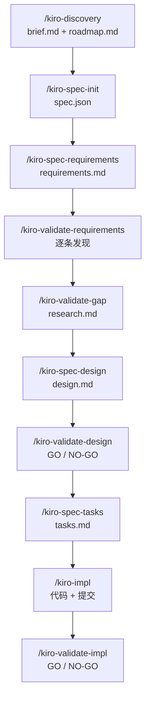

# Kiro SDD 到底是怎么跑的，又靠什么保证 spec 不跑偏

这份分析回答两个问题：**这套流程在机制上是怎么执行的**，以及**它用什么手段保证 spec 的质量和一致性**。最后一段说明这套机制的代价，为《proposal.md》里的改造方案做铺垫。

文中所有判断都基于本仓库的定制版 skill、规则、模板和 `CLAUDE.md`，不泛指官方 Kiro 实现。中文译本的对照文件在同目录的编号文件里。

---

## 一、流程是怎么执行起来的

### 1.1 主链路：六个阶段、三份产物、一个状态机



对应到文件与状态：

| 阶段 | 命令 | 落盘产物 | `spec.json` 变化 | 谁来验 |
|---|---|---|---|---|
| 初始化 | `/kiro-spec-init` | `spec.json` | `phase: "initialized"`，三个 `approvals.*.generated` 全为 `false` | — |
| 需求 | `/kiro-spec-requirements` | `requirements.md` | `phase: "requirements-generated"`、`approvals.requirements.generated: true` | 需求评审门禁（内置）；可选外挂 `/kiro-validate-requirements` |
| 差距 | `/kiro-validate-gap` | `research.md` | 不推进阶段 | — |
| 设计 | `/kiro-spec-design` | `design.md`、`research.md` | `phase: "design-generated"`、`approvals.design.generated: true` | 设计评审门禁（内置）；可选外挂 `/kiro-validate-design` |
| 任务 | `/kiro-spec-tasks` | `tasks.md` | `phase: "tasks-generated"`、`approvals.tasks.generated: true` | 任务计划门禁 + 任务图独立体检 |
| 实现 | `/kiro-impl` | 代码、`git commit`、`tasks.md` 复选框 | 不改 `phase`，只改任务勾选 | 任务级评审 + `kiro-verify-completion` |
| 特性校验 | `/kiro-validate-impl` | 校验报告（对话输出） | 不改 | 机械检查 + 判断检查 + 新鲜证据 |

状态机定义在 [init.json](<.kiro/settings/templates/specs/init.json#L6-L21>)：`phase` 加上 `approvals.{requirements,design,tasks}.{generated,approved}`，加一个 `ready_for_implementation` 布尔。字段很少，但足以让每个 skill 在启动时判断"我该不该干活"。

### 1.2 最关键的一条执行纪律：草稿不落盘

三个生成型 skill 都有一条相同的节奏：

> 在工作记忆里写草稿 → 跑门禁 → 修（最多 2 轮） → **通过后才写文件**。

依据见 [requirements skill 第 3–5 步](<.claude/skills/kiro-spec-requirements/SKILL.md#L50-L74>)、[design skill 第 4–6 步](<.claude/skills/kiro-spec-design/SKILL.md#L104-L145>)、[tasks skill 第 3–4 步](<.claude/skills/kiro-spec-tasks/SKILL.md#L73-L120>)。

这条纪律带来两个效果：

1. **磁盘上只会存在"曾经通过门禁"的版本**。后续校验读到的文件，天然带着一次质量基线，不需要怀疑"这是不是还没写完的稿子"。
2. **门禁失败不会污染已有产物**。重跑某个阶段时，如果新草稿不过关，旧文件原地不动，不存在"改坏了回不去"的状态。

### 1.3 内环与外环：生成者自检 + 独立评审

流程里其实有**两套**检查，容易混淆：

**内环（生成 skill 自带，生成者自己跑）**

| 门禁 | 位置 | 检查什么 | 越界怎么办 |
|---|---|---|---|
| Requirements Review Gate | [requirements-review-gate.md](<.claude/skills/kiro-spec-requirements/rules/requirements-review-gate.md>) | 覆盖度、EARS 合规、实现词泄漏、数字 ID | 局部修；真歧义 → 停下问人 |
| Design Review Gate | [design-review-gate.md](<.claude/skills/kiro-spec-design/rules/design-review-gate.md>) | 需求追溯、边界四节非空、File Structure Plan、孤儿组件 | 局部修；真缺口 → 回需求 |
| Task Plan Review Gate | [tasks-generation.md](<.claude/skills/kiro-spec-tasks/rules/tasks-generation.md#L126-L155>) | 覆盖度、可执行性、粒度、前置条件、标注一致性 | 局部修；真缺口 → 回设计 |
| Task-Graph Sanity Review | [tasks skill 第 3.5 步](<.claude/skills/kiro-spec-tasks/SKILL.md#L91-L109>) | 只查依赖、排序、边界重叠、任务大小 | `PASS` / `NEEDS_FIXES` / `RETURN_TO_DESIGN` |

**外环（独立 skill，另一个动作）**

| 校验 | 性质 | 输出 |
|---|---|---|
| `/kiro-validate-requirements` | 串行、一次只抛一个发现 | 发现清单，**不批准阶段** |
| `/kiro-validate-design` | 交互式、最多 3 个关键问题 | GO / NO-GO |
| `/kiro-validate-impl` | 机械检查 + 判断检查 + 边界审计 | GO / NO-GO / MANUAL_VERIFY_REQUIRED |

两者分工明确：内环保证"产物形状对"，外环负责"内容判断"。内环偏机械，外环偏判断。

值得注意的是**任务图体检是唯一被要求"换一个上下文"的内环检查**。它明确要求：如果可以，派一个全新子代理，只给文件路径和草稿，**不给父上下文综合出来的覆盖度摘要**，让评审者自己读 `requirements.md`、`design.md` 和规则。这是整套流程里第一次系统性地防范"生成者自己给自己打分"。

### 1.4 缺口不向下兼容：三种回退语义

三个门禁都写了同一类兜底，用词不同，语义一致：

- 设计评审发现真缺口 → "停下来回到需求澄清，不要在 `design.md` 里糊过去"（[design skill](<.claude/skills/kiro-spec-design/SKILL.md#L133>)，原文 "instead of papering over it"）。
- 任务评审发现真缺口 → "停下来把用户送回需求/设计阶段，不要靠编造填充任务把坑填上"（[tasks skill](<.claude/skills/kiro-spec-tasks/SKILL.md#L89>)）。
- 任务图体检 → `RETURN_TO_DESIGN` 时**不写** `tasks.md`（[tasks skill](<.claude/skills/kiro-spec-tasks/SKILL.md#L108>)）。

配合"最多 2 轮修复"的上限，形成一个明确的收敛规则：

> 能就地修的，两轮内修完；修不完的，说明不是局部问题，必须回到上游。

这条规则比"允许多轮修复"重要得多。多轮修复在 Agent 场景下等价于无限自我说服。

### 1.5 实现阶段：一条子代理流水线

`/kiro-impl` 的自治模式不是"一把梭"，而是一个**每个子任务跑一遍的固定流水线**（[kiro-impl](<.claude/skills/kiro-impl/SKILL.md#L81-L160>)）：

```text
派实现者子代理 → 读结构化 STATUS
  ├─ READY_FOR_REVIEW → 派评审子代理 → 读结构化 VERDICT
  │    ├─ APPROVED → kiro-verify-completion（新鲜证据）→ 勾选任务 → 选择性提交
  │    └─ REJECTED（1–2 轮）→ 带反馈重派实现者
  │         └─ REJECTED（第 3 轮）→ 派调试子代理
  ├─ BLOCKED → 派调试子代理
  └─ NEEDS_CONTEXT → 补上下文重派一次，仍不行 → 派调试子代理
```

几个设计上的硬约束：

- **一迭代只做一个子任务**，不批量派发。
- **只认结构化字段**：`STATUS:` 与 `VERDICT:` 缺失就必须重派，不允许从散文里猜。
- **评审者自己跑 `git diff`**，实现者的自述只能当参考（[kiro-review](<.claude/skills/kiro-review/SKILL.md#L56-L63>)）。
- **调试子代理在全新上下文里跑**，只拿错误信息、`git diff` 和 spec 路径，避免"带着失败历史继续重试"的污染。
- **有限次数的闭环**：评审驳回 2 轮 → 调试；调试 2 轮仍失败 → 标 `_Blocked:_` 跳过；最终整改 3 轮仍 NO-GO → 停下报告。
- **提交是父上下文独占的**，且禁止 `git add -A`。

### 1.6 完成不是一个勾，是一个证据门

`kiro-verify-completion` 把"宣称"和"证据"分开（[kiro-verify-completion](<.claude/skills/kiro-verify-completion/SKILL.md#L57-L65>)），给出三态结论：`VERIFIED` / `NOT_VERIFIED` / `MANUAL_VERIFY_REQUIRED`。

它的核心不是"再跑一遍测试"，而是两条规则：

1. **证据必须是当前的**。"早先测试通过"不算，"子代理说成功了"不算。
2. **结论不得宽于证据**。`FEATURE_GO` 要求全量测试 + 运行时存活 + 需求覆盖 + 跨任务集成 + 设计端到端对齐 + 阻塞任务状态；只有测试通过，不够。

这条门禁是本仓库对 Kiro 原版最实质的强化。它把"完成"从"任务清单勾满"改成"批准的每一项都有对应证据"。

---

## 二、质量是靠什么保证的

质量保障机制可以分成六层。从下往上，成本递增，覆盖面递减。

### 第 1 层：模板即 schema

三份模板不是"写作建议"，而是**结构契约**：

- [requirements.md 模板](<.kiro/settings/templates/specs/requirements.md>)：需求编号 + 目标 + 验收条件。
- [design.md 模板](<.kiro/settings/templates/specs/design.md>)：固定章节，其中 `Boundary Commitments` / `Out of Boundary` / `Allowed Dependencies` / `Revalidation Triggers` / `File Structure Plan` 是必填项。
- [tasks.md 模板](<.kiro/settings/templates/specs/tasks.md>)：两级编号 + 复选框 + 元数据标注。

模板的价值不在"统一好看"，而在于**让"缺内容"变成可检测的形状**。评审门禁需要检查"边界章节非空"，前提是边界章节是结构的一部分。没有模板，检查就退化成主观判断。

### 第 2 层：机械检查先于判断

每个门禁都明确写了顺序："先跑机械检查，再做判断类评审"（[requirements-review-gate](<.claude/skills/kiro-spec-requirements/rules/requirements-review-gate.md#L39-L50>)、[design-review-gate](<.claude/skills/kiro-spec-design/rules/design-review-gate.md#L36-L50>)）。

机械检查清单（可直接执行，不依赖品味）：

| 检查 | 判据 |
|---|---|
| 需求标题有数字 ID | 逐个标题扫描；混用字母编号直接失败 |
| 每条需求有验收条件 | 存在 `When` / `If` / `While` / `Where` 语句 |
| 需求里没有技术词 | 扫数据库名、框架名、API 模式 |
| 设计覆盖全部需求 ID | 抽出全部 `N.M`，逐个在设计里搜 |
| 边界四节非空 | `Boundary Commitments` 等四节不能是占位符 |
| File Structure Plan 有具体路径 | 不能是 `TBD` 或空白 |
| 没有孤儿组件 | 设计里的组件必须在 File Structure Plan 有文件 |
| 任务元数据合法 | 每个任务恰好一个 `_Test profile:`，`full` 必须有 `_Full environment:_` |
| 交付物真实存在 | `grep TBD\|TODO\|FIXME\|HACK\|XXX`、`grep` 硬编码密钥 |
| 运行时能起来 | smoke 命令的退出码 |

机械检查的价值是**降低争论成本**。一条"边界章节为空"的结论不需要解释，也不容辩解。

### 第 3 层：编号即契约

这是整套流程里最被低估、也最值得继承的机制。

同一条需求，在不同文档里用**同一个数字**出现：

```text
requirements.md   需求 2 → 验收条件 2.1、2.2、2.3
design.md         _Requirements: 2.1, 2.3_   （组件表、追溯表）
tasks.md          _Requirements: 2.1, 2.3_
测试计划           指向 2.1、2.3
validate-impl     "使用 requirements.md 的原始章节编号"
```

而且反复强调"不要自造 ID"：

- [design skill](<.claude/skills/kiro-spec-design/SKILL.md#L154>)：只用数字 ID，必须与 `requirements.md` 一致，不得自造。
- [tasks-generation](<.claude/skills/kiro-spec-tasks/rules/tasks-generation.md#L84-L89>)：`_Requirements:` 只列数字，不得附加描述性后缀。
- [validate-impl](<.claude/skills/kiro-validate-impl/SKILL.md#L130-L134>)：用原始章节编号，**"不要自造 `REQ-*` 别名"**。
- [kiro-impl](<.claude/skills/kiro-impl/SKILL.md#L94>)：给实现者的提示词里传"确切的章节编号，用源编号而不是自造别名"。

这就是"一致性"的实际实现方式：**一致性不是靠人记住，而是靠 ID 引用把多份文档钉在一起**。ID 一旦漂移，机械检查就会失败。

### 第 4 层：边界三段式

边界在这套流程里有一个贯穿四阶段的固定词表：

```text
发现：Boundary Candidates
需求：显式的包含 / 排除 / 相邻预期
设计：Boundary Commitments + Out of Boundary + Allowed Dependencies + Revalidation Triggers
任务：_Boundary:_ 约束执行范围
校验：Boundary Violations 判定溢出
```

这不是命名洁癖，而是把"范围蔓延"从一种感觉变成一条可判定的违规：

- 设计门禁要求"边界必须能用几条直白条目说清"，否则"对任务生成来说还是太虚"。
- 任务门禁要求"跨边界的活儿必须做成显式集成任务"，禁止藏在本地任务里。
- 评审协议里有专门一节 `Boundary Audit`，明确列出要拒绝的形态："上游为了方便嵌进下游假设"、"新增未声明的隐藏依赖或共享权属"。
- 特性校验里更有 `G.5 Boundary Audit`，把"跨任务溢出"和"为了集成方便而嵌进上游的下游变通"列为必须发现的问题。

配合 `Allowed Dependencies` 与依赖方向约束（"每层只能导入左手边的层，绝不允许向上"，[design-principles](<.claude/skills/kiro-spec-design/rules/design-principles.md#L59-L63>)），"谁该依赖谁"也变成了可检查项。

### 第 5 层：防重复与单一权威

`CLAUDE.md` 的"权威来源纪律"（[CLAUDE.md](<CLAUDE.md#L70-L77>)）是这套机制的一致性底座：

> 一个含义、术语、数值边界或产品规则，只保留唯一一个权威来源；其他地方只能引用，不得复制、不得改写成同义词、不得另造并行术语。

这条纪律在设计模板里被具体化成几条去重规则：

- `design.md` 必须自包含，`research.md` 只作背景，结论必须回写到设计（[design 模板](<.kiro/settings/templates/specs/design.md#L63-L65>)）。
- 图里已经表达的内容不在正文重复，正文只写"决策、取舍、影响"。
- 汇总表已覆盖的关系，别处不再重写。
- 组织级标准（steering）只引用，不在每个 spec 里重述。

后果是：**同一个事实只有一处可改**。文档之间是引用关系，不是复制关系。这是"一致性"能长期维持的前提——复制出来的多份副本迟早会漂移。

### 第 6 层：证据与独立视角

最上层是三条"反自欺"规则：

1. **新鲜证据**（见 1.6）。
2. **独立评审者**：评审者读 spec、读 diff、自己跑命令，不采信实现者的结论；结构化交接只认 `STATUS:` 与 `VERDICT:` 字段。
3. **失败归因**：`validate-impl` 要求把失败分成 `LOCAL` / `UPSTREAM` / `UNCLEAR`，上游问题不得就地打补丁，必须回到所属规格，并重新校验下游。

第 3 条尤其重要。它把"在这里绕过一下"这种最常见的质量腐蚀，变成了一个必须显式回答的归属问题。

---

## 三、一致性还依赖什么：状态、steering 与单一来源

除了上面六层，还有三样东西在支撑"多规格之间的一致性"：

1. **唯一状态机**：只有 `spec.json` 记录阶段与审批。skill 不靠"文件存在"猜进度，靠字段判断。
2. **steering 作为项目记忆**：`product.md`、`tech.md`、`structure.md` 加领域文件，被所有阶段加载。跨 spec 的一致性（命名、分层、测试档位、数据模型契约）都靠它，而不是靠每个 spec 自己重新定义。`_Test profile:` 的语义就明确由 [testing-profiles.md](<.kiro/steering/testing-profiles.md>) 拥有，tasks skill 只引用（[tasks skill](<.claude/skills/kiro-spec-tasks/SKILL.md#L31>)）。
3. **规则集中在 `rules/`**：每个 skill 的判定标准放在同目录 `rules/` 下，被 SKILL.md 显式引用。改规则只改一处。

这里有一个**需要先核实的前提**：我按当前工作树核对过，本仓库只有 `.claude/skills/` 这一份 skill 副本，`.agents/skills/` 并不存在（你在对话文档里引用的 `.agents/skills` 路径，应该是另一个时间点或另一台机器上的状态）。

也就是说，"双副本漂移"在当前快照上不成立。但它仍然是个需要注意的风险面：这套流程文件在历史上被复制到过多个位置，而 `kiro-spec-status` 这类消费方是按"三份文档 + spec.json"的固定结构读文件的。**改造时先确认运行时实际加载哪一份 skill，再动手**，否则最容易的结果是改了一份、跑的是另一份。

---

## 四、这套机制的代价

机制本身没有错，问题在于**它为谁优化**。

### 4.1 产物是按阶段切的，不是按读者切的

一份小改动要产出 `requirements.md`、`research.md`、`design.md`、`tasks.md` 四份文件。读者想判断"这件事做得对不对"，必须同时打开至少三份，在编号之间来回跳：

```text
读任务 → 查设计里的组件与文件 → 查需求里的验收条件 → 回任务判断是否完整
```

对多人团队，这种切分有价值：需求给产品看，设计给架构看，任务给执行者看。对一个全栈个人开发者，它只是把同一件事拆成三个阅读入口。

### 4.2 语言是为 Agent 压缩的

EARS 规则要求固定短语保留英文、只本地化变量部分（[ears-format.md](<.claude/skills/kiro-spec-requirements/rules/ears-format.md#L4-L8>)）。所以即使选中文，产出也是中英混排的标准化句式：

> When 用户点击删除按钮, the DeleteService shall 校验权限。

这种句子对机器友好（可正则、可解析、条款边界清晰），对人则是"每条都对，读完不知道用起来是什么感觉"。真正的用户场景被拆成互不相邻的条款，读者要自己还原操作顺序和因果。

### 4.3 门禁密度高，但批准不绑定内容

CLAUDE.md 的流程里有三个常规人工审批点（需求、设计、任务）。但 `spec.json` 的审批字段只有布尔值：

```json
"approvals": { "requirements": { "generated": true, "approved": true } }
```

它记录"批准过"，不记录"批准的是哪一版内容"。后果很直接：文档改一版，旧的 `approved: true` 依然为真。审批变成一个可以被继承的状态，而不是一次针对具体文本的判断。这就是"机械同意"在机制层面的根源——**批准没有指纹，自然也不需要真的读**。

### 4.4 质量保障的对象是文档形状，不是人的理解

六层机制里，只有第 6 层的独立评审勉强触及"设计是否合理"，其余全部在保"文档是否完整、编号是否对齐、边界是否写全"。这解释了为什么流程越跑越熟，人却越来越没参与感：机制在保证**产物合格**，没有机制在保证**审阅者真的看懂了**。

### 4.5 维护面在扩大

同一套规则至少要在四个地方同步：`CLAUDE.md`（流程入口）、各 `SKILL.md`（编排）、各 `rules/*.md`（判定标准）、`.kiro/settings/templates/*`（结构）。这四处里任何一处漏改，流程就会自相矛盾。改造时这是最容易踩的坑：只改三个生成 skill，`kiro-impl`、`kiro-spec-status`、`kiro-validate-impl` 仍会按旧结构读文件，然后在实现阶段静默退回旧行为。

---

## 五、一句话总结

> Kiro 用"草稿不落盘 + 机械检查 + 编号引用 + 边界词表 + 单一权威 + 新鲜证据"这套组合，把 spec 的**形式质量**做到了可重复、可判定、低争论。
>
> 它没有解决的问题是：产物的组织方式服务的是阶段和 Agent，不是审阅者；审批字段记录的是状态，不是内容；于是流程越规范，人的判断越容易被形式替代。

这两点正是《proposal.md》要动的地方：**保留这套质量机器，换掉它的阅读入口和审批语义。**
